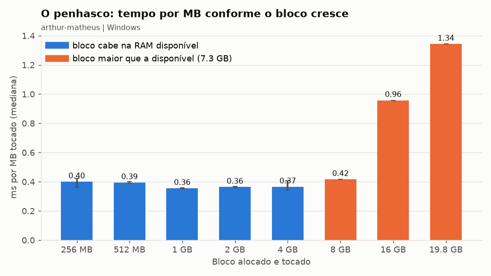
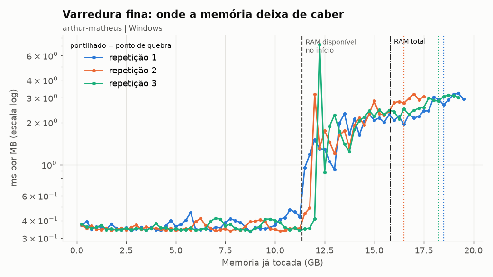

# Relatório: o penhasco da memória virtual

## 1. Identificação

- Dupla (id): arthur-matheus
- Integrantes: Arthur Reis e Matheus Assis
- SO e versão: Windows 11 (10.0.26200)
- CPU: Intel Core i5-10400 @ 2,90 GHz (12 núcleos lógicos)
- RAM total: 15,8 GB
- RAM disponível (available) no passo 1.1: 7,5 GB
- Tamanho da página: 4096 bytes

## 2. Hipótese (escrita ANTES de rodar o 02)

- Alternativa escolhida (A, B, C ou D): C
- Bloco em que esperamos o salto: 8 GB (é o primeiro bloco maior que os 7,5 GB disponíveis; 4 GB ainda cabe)
- Justificativa (1 frase, usando a tabela de latências do slide): a RAM leva cerca de 80 ns e o SSD NVMe cerca de 50 000 ns, uma diferença de 625x, então quando o bloco passar da RAM disponível cada página nova vai precisar expulsar outra para o disco e o tempo por MB deve subir de 10x a 100x.

## 3. Medição: tabela do slide (saída do 02)

| Bloco | ms/MB (mediana) | major faults | swap ativo? |
|---|---|---|---|
| 256 MB | 0,400 | n/d | não |
| 512 MB | 0,394 | n/d | não |
| 1 GB | 0,355 | n/d | não |
| 2 GB | 0,363 | n/d | não |
| 4 GB | 0,365 | n/d | não |
| 8 GB | 0,416 | n/d | sim |
| 16 GB | 0,958 | n/d | sim |
| 19,8 GB | 1,343 | n/d | sim |

O Windows não separa faltas leves de pesadas, por isso major faults aparece como n/d.

Em qual linha o ms/MB explodiu? Não houve explosão: o primeiro salto claro é a linha de 16 GB (0,96 ms/MB) e o maior é a de 19,8 GB (1,34 ms/MB). Salto em relação aos blocos pequenos (base de 0,365 ms/MB): 2,6x em 16 GB e 3,7x em 19,8 GB.

A hipótese se confirmou? Só em parte: acertamos que o tempo sobe depois da RAM, mas o bloco de 8 GB (maior que os 7,3 GB disponíveis) ficou em apenas 1,1x e o maior salto do 02 foi 3,7x, bem abaixo dos 10x a 100x que esperávamos.

## 4. Ponto de quebra (saída do 03) e gráfico

- Ponto de quebra (mediana das repetições): 18688 MB (repetições: 18944, 16896 e 18688 MB)
- IC 95% do ponto de quebra: [15404, 20948] MB (n = 3, média 18176 MB, desvio 1116 MB)
- Quebra / RAM disponível: 1,45 (nas três repetições: 1,63, 1,35 e 1,45)
- Bateu com a RAM disponível? Pelo critério do script (fatia 8x mais lenta que a base), não: o ponto de quebra ficou 1,35x a 1,63x acima da RAM disponível. Olhando as fatias, a primeira subida aparece quando o "disponível" chega a 0, com 11,8 a 12,5 GB tocados, que é a RAM disponível do início da varredura (11,6 a 12,9 GB, razão de 0,97 a 1,01), e nesse ponto o custo vai de 0,35 para 1 a 7 ms/MB. Depois disso o custo cresce devagar, de 1 para cerca de 3 ms/MB, e só cruza o limiar de 8x por volta de 17 a 19 GB, porque o Windows vai gravando as páginas antigas no arquivo de paginação aos poucos em vez de travar de uma vez. A disponível do 03 (11,6 a 12,9 GB) é maior que a do passo 1.1 (7,5 GB) porque o 02 empurrou páginas de outros programas para o swap (o swap usado foi de 5,8 para 8,5 GB).

Gráficos:

## 5. TLB (saída do 04)

- Previsão antes de rodar: o custo sobe a partir do passo de 4096 bytes.
- Resultado: o custo sobe a partir do passo de 4096 bytes, 2,9x o passo de 64 B (7,01 contra 2,38 ns por acesso); em 64 KB chega a 10,02 ns, 4,2x. Já havia uma subida suave em 256 B (1,2x) e 1 KB (1,6x).
- Explicação (1 a 2 frases): até 1 KB as 8192 leituras visitam de 128 a 2048 páginas, que a TLB ainda consegue manter; a partir de 4 KB cada leitura cai em uma das 8192 páginas distintas, que são mais traduções do que a TLB guarda, então quase todo acesso vira TLB miss e um page walk na tabela de páginas, mesmo com os dados (512 KB) cabendo no cache.

## 6. Discussão (Think-Pair-Share)

- Resposta individual (CPU melhor ou mais RAM? Use o gráfico): mais RAM. Com a CPU a 30% e o swap ativo, o tempo está sendo gasto esperando páginas irem para o disco, não calculando. No nosso gráfico o tempo por MB fica em 0,35 ms/MB enquanto a memória cabe e passa de 1 ms/MB, chegando a cerca de 3 ms/MB (9x), depois que o disponível zera; uma CPU mais rápida não mexe nessa curva, e mais RAM empurra o ponto de quebra para a direita.
- Uma diferença observada em relação à dupla de outro SO, e uma explicação: não tivemos os dados de uma dupla de outro SO, então comparamos com a medição real de macOS (Apple M1, 8 GB) que está em `dados/exemplo`. No macOS o salto foi bem maior (43,8x nos blocos e 25,9x na varredura fina, contra 3,7x e 8,6x no Windows) e a TLB piorou no passo de 16 KB, não no de 4 KB (4,29 contra 1,32 ns). O passo de 16 KB é a página do Apple Silicon. A diferença de salto provavelmente vem da base: o M1 toca a memória em 0,084 ms/MB, quatro vezes mais rápido que os 0,365 do nosso PC, então o custo do swap pesa mais em relação a ele.

## 7. As 4 perguntas obrigatórias

1. **O que foi medido?** O tempo para tocar (escrever em) memória virtual, em ms por MB, com blocos cada vez maiores (256 MB até 19,8 GB) e em fatias de 256 MB para achar o ponto de quebra; a RAM disponível e o swap usado durante os testes; e o custo por acesso, em ns, ao ler com passos de 64 B a 64 KB (efeito da TLB).

2. **Como foi medido?** Com os scripts em Python deste repositório: `mmap` anônimo, cada página preenchida com bytes aleatórios (o SO não consegue comprimir) e tempo com `perf_counter_ns`. No 02, 1 aquecimento e 5 repetições nos blocos que cabem (até 80% da RAM disponível) e 1 execução nos maiores, com mediana e IC 95%; no 03, 3 varreduras em fatias de 256 MB, e o ponto de quebra é a primeira de 3 fatias seguidas 8x mais lentas que a base; no 04, 8192 leituras, 500 voltas e 20 repetições por passo. O swap foi confirmado com o `monitor_memoria.py` rodando em paralelo: o disponível caía a 0 MB (RAM em 100%) enquanto o swap usado subia de 5,8 GB para 16 GB, a cerca de 350 MB/s, e voltava a cair quando o bloco era liberado. A coluna "swap ativo?" da tabela vem do crescimento do swap usado, porque o Windows não expõe os contadores si/so nem os major faults.

3. **Por que esse resultado?** O primeiro toque em cada página gera um minor fault: o SO só entrega um frame zerado, sem acesso a disco, e isso custa os cerca de 0,35 ms/MB da base (uns 1,4 µs por página de 4 KB). Quando a RAM acaba, cada página nova exige tirar outra da memória e gravá-la no arquivo de paginação, e o disco é muito mais lento que a RAM. O major fault, que lê a página de volta do disco, só acontece se um programa tocar de novo uma página que já foi para o swap, e o nosso teste escreve cada página uma única vez, em sequência. Por isso o custo foi o de gravar em lotes seguidos no disco (2 a 3 ms/MB, perto dos 350 MB/s do swap) e não o de uma leitura aleatória de 4 KB a 50 µs por página (12,8 ms/MB), e o salto ficou em 3x a 9x e não em 100x. O bloco de 8 GB quase não mudou provavelmente porque o Windows conseguiu tirar da RAM páginas de outros programas antes de ser preciso gravar as nossas. No TLB, a partir de 4 KB cada leitura visita uma página diferente, passa da capacidade da TLB e paga um page walk.

4. **Qual teoria explica?** Memória virtual com paginação sob demanda: o espaço de endereços é dividido em páginas de 4 KB, que só ganham um frame de RAM no primeiro acesso (page fault), e a RAM funciona como um cache do disco, com o swap como nível abaixo e uma política de substituição que escolhe quem sai. A diferença de latência da hierarquia de memória (80 ns da RAM contra 50 000 ns do SSD) é o que cria o penhasco quando o conjunto de páginas em uso passa da RAM. A tradução de endereço virtual para físico passa pela tabela de páginas e pela TLB, que é um cache de traduções; quando as páginas visitadas passam do que ela guarda, cada acesso paga o page walk.
